<picture>
  <source media="(max-width: 600px)" srcset="./assets/header-mobile.svg" />
  
</picture>

I make tools for working with coding agents. Most of my projects are for OpenCode; others cover code search, GitHub research, and testing.

这里主要放我写的 OpenCode 插件和配套工具，也有一些用于代码搜索、项目调研和测试的 MCP 工具与 Skills。

## OpenCode tools

- [**vscode-opencode-v2**](https://github.com/ThinkDonk/vscode-opencode-v2) 
  OpenCode in VS Code, with file, selection, and diagnostic references sent to the terminal.

- [**opencode-alert**](https://github.com/ThinkDonk/opencode-alert) 
  Desktop and sound alerts when a session finishes, fails, or needs permission. Includes filters and quiet hours.

- [**opencode-opentrace**](https://github.com/ThinkDonk/opencode-opentrace) 
  A read-only view of local sessions, token usage, costs, tool calls, and sub-agent traces.

## MCP & developer skills

- [**ast-grep-mcp**](https://github.com/ThinkDonk/ast-grep-mcp) 
  An MCP wrapper for ast-grep: search and replace code by syntax, with a preview before writing.

- [**github-landscape**](https://github.com/ThinkDonk/github-landscape) 
  A Codex skill and Python helper for comparing GitHub projects: features, maintenance, and known limitations.

- [**commit-test**](https://github.com/ThinkDonk/commit-test) 
  Check Git changes against a running app through real pages, and save a record of what was tested.

## Other projects

[**VideoNexus**](https://github.com/ThinkDonk/VideoNexus) — A video portal for GB28181 cameras, with channel permissions, audit logs, and recording downloads. FastAPI + Vue 3, on top of WVP-GB28181-pro and ZLMediaKit.

More projects &amp; earlier work

- [**llm-safe-write**](https://github.com/ThinkDonk/llm-safe-write) — A skill for writing large or CJK files in smaller edits when a tool hits truncation errors.
- [**sso-service**](https://github.com/ThinkDonk/sso-service) — An OIDC authentication service for Outline Wiki.
- [**ExcelToSqlServer**](https://github.com/ThinkDonk/ExcelToSqlServer) — An earlier ASP.NET WebForms example for Excel import, duplicate checking, and transactional bulk inserts.

## Working with

     

Found a bug or have an idea? Open an issue in the relevant repo. English or Chinese is fine.
